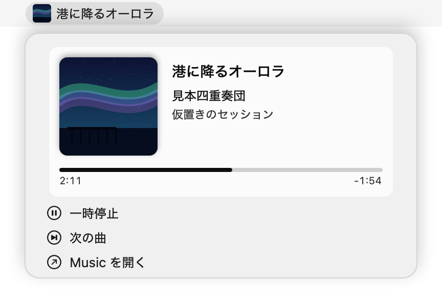
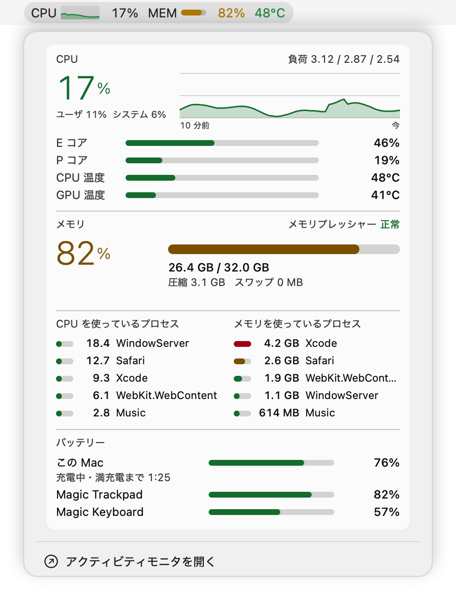
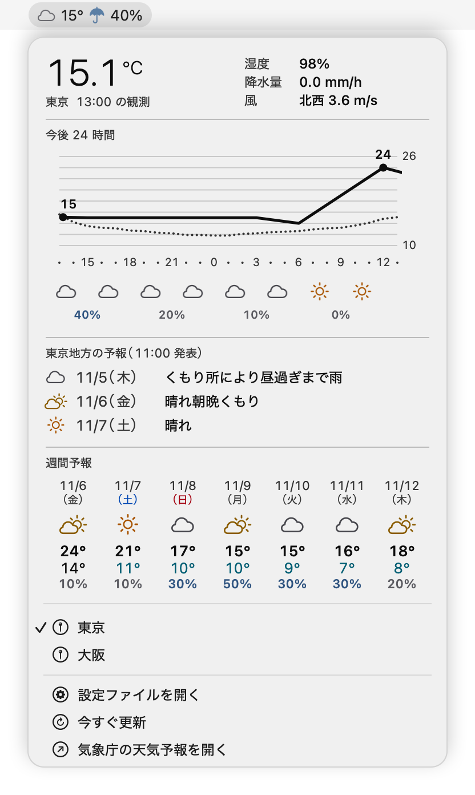

# swiftbar-cards

[English](README.md)

メニューの中身を、文字の行ではなく画像のカードで描く [SwiftBar](https://github.com/swiftbar/SwiftBar) のプラグインです。

| プラグイン | メニューバー | カード |
|---|---|---|
| `nowplaying` | Music.app で再生中の曲のアートワークと曲名 | アートワーク・曲名・アーティスト・アルバム・再生位置と、一時停止・次の曲の項目 |
| `sysmon` | CPU の推移、メモリ、本体のバッテリーと残り時間か満充電までの時間 (MacBook)、温度 | CPU (使用率・過去 10 分の推移・E / P コア・温度)、メモリ、CPU とメモリを使っているプロセスの上位、バッテリー (MacBook では本体の残量と、充電中か・残り時間・満充電までの時間。Bluetooth 機器の残量も) |
| `weather` | 今日の天気のアイコン、現在の気温、降水確率 | 気象庁のデータによる現在の観測値、今後 24 時間の気温のグラフ、地方の予報、週間予報 |

カードは小さな Swift のプログラムが描き、画像として SwiftBar に渡します。ライトモードとダークモードで別の色を使います。表示は macOS の言語の設定に合わせて、日本語か英語になります。

<p align="center">
  <picture>
    <source media="(prefers-color-scheme: dark)" srcset="docs/images/ja/nowplaying-dark.png">
    
  </picture>
  <picture>
    <source media="(prefers-color-scheme: dark)" srcset="docs/images/ja/sysmon-dark.png">
    
  </picture>
  <picture>
    <source media="(prefers-color-scheme: dark)" srcset="docs/images/ja/weather-dark.png">
    
  </picture>
</p>

`nowplaying` と `sysmon` の画像は `samples/` の架空の値で描いたもので、`weather` の画像は東京の実際の予報です (2 つめの地点に大阪を設定しています)。

## 必要なもの

- macOS 15 以降の Apple シリコンの Mac (M1 Max・macOS 26 で確かめています)。`weather` は macOS に付属の `curl` と `jq` を使います
- 常駐型 (streamable) のプラグインに対応した SwiftBar
- `swiftc` を使うための Xcode Command Line Tools (`xcode-select --install`)
- `weather` で現在地を出すには、位置情報サービス (無くても東京を表示します)

## インストール

```sh
git clone https://github.com/delphinus/swiftbar-cards.git
```

SwiftBar の設定で、プラグインのフォルダをクローンした中の `plugins` ディレクトリにします。プラグインは隣の `Sources` と `scripts` ディレクトリから Swift のプログラムをビルドするので、プラグインのファイルを 1 つずつ別の場所へコピーしたりリンクしたりしないでください。

各プラグインは、初回とソースを変えたときに Swift のプログラムをコンパイルします。できたバイナリは `~/Library/Caches/` の下に置かれます。

`nowplaying` は再生中の曲を AppleScript で Music.app に問い合わせます。初回は、SwiftBar から Music を操作してよいかを macOS が尋ねます。

`weather` は現在地を調べるのに位置情報サービスを使います。初回は、`swiftbar-cards` というアプリに位置情報の利用を許可するかを macOS が尋ねます (詳しくは「[設定](#設定)」)。

## 言語

macOS の優先する言語の先頭が日本語なら日本語で、それ以外なら英語で表示します。設定によらず決めたいときは、SwiftBar に環境変数 `SWIFTBAR_CARDS_LANG` (`ja` か `en`) を渡します。

英語のとき、`weather` は観測点や区域の名前に気象庁の英語名を使います。予報の文は気象庁が日本語でしか出していないので、代わりに各日の天気コードの英語名 (「Partly cloudy」など) を出します。

## 設定

`weather` は、現在地にいちばん近い (気温を観測している) アメダスの観測点の天気を表示します。現在地は macOS の位置情報サービスで調べます。SwiftBar 自身は位置情報を使えないので、位置情報を読むだけの小さなアプリ (`swiftbar-cards`。Dock にもメニューバーにも出ません) を `~/Library/Caches/swiftbar-weather/` に作って使います。初回は、このアプリに位置情報の利用を許可するかを macOS が尋ねます。現在地は 10 分ごとに調べ直します。許可されていないときや取得できないときは東京を表示し、メニューに理由を出します。

ほかの地点も見るには、アメダスの観測点の名前 ([気象庁のアメダスのページ](https://www.jma.go.jp/bosai/amedas/)に出ているもの) を `~/.config/swiftbar-cards/weather.conf` に書きます。

```ini
place=東京
place=大阪
```

メニューには、先頭の「現在地 (府中)」(括弧の中は使っている観測点) に続いて、書いた地点が並び、選んで切り替えられます。各地点の項目には、その地点を最後に更新したときの天気のアイコン・気温・降水確率を、メニューバーと同じ形で添えます。表示している地点はアイコンが塗りつぶされ、選んだ地点は覚えておきます。ファイルを書き換えたあとは、メニューの「今すぐ更新」で、次の更新 (10 分ごと) を待たずに反映できます。メニューの「設定ファイルを開く」を選ぶと、ファイルが無ければ説明付きのひな形を作って開きます。

予報の区域は観測点から決まります。同じ地域の中で、予報の気温の代表の地点が観測点にいちばん近い区域を使います。

現在地を先頭以外に置くには、置きたい位置に `place=現在地` (または `place=here`) と書きます。

```ini
place=東京
place=現在地
```

同じ名前の観測点が複数あるときは、メニューに候補が観測点の番号付きで出ます。名前の代わりに番号を書いてください。

```ini
place=44116
```

## 開発

- Swift のプログラムは Swift のパッケージの形 (`Package.swift`) にしてあるので、`swift build` やエディタの補完がそのまま使えます。プラグイン自身は SwiftPM を通さず、`swiftc` で直接コンパイルします。
- `tests/smoke.sh` は、Swift のプログラムをビルドし、各プラグインを動かして、メニューバーの行とカードの画像が出るかを確かめます。CI が push のたびに流します。
- `samples/render.sh` は `docs/images/en/` と `docs/images/ja/` の画像を描き直します。`nowplaying` と `sysmon` は `--render <JSON> <出力先>` で、与えた値から 1 回だけカードを描けます。値は `samples/` にあります。
- リリースは [Semantic Versioning](https://semver.org/lang/ja/) に従い、`vX.Y.Z` のタグを打ちます。版はすべてのプラグインで共通で、ヘッダの `<xbar.version>` に書きます (SwiftBar のプラグインの設定画面に出ます)。そろっているかは `tests/smoke.sh` が確かめます。
- `scripts/update-telops.sh` は、天気コードの英語名の表 `data/jma-telops.json` を、気象庁の予報のページに埋め込まれた表から作り直します。

## 謝辞

`sysmon` は、[macmon](https://github.com/vladkens/macmon) (MIT License) と同じ方法で SMC から温度を読んでいます。

## ライセンス

[MIT](LICENSE)
