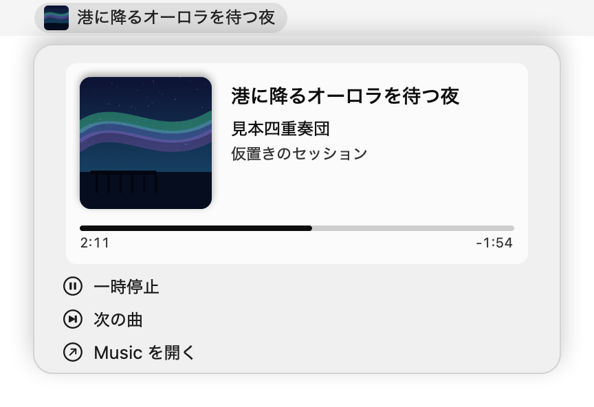
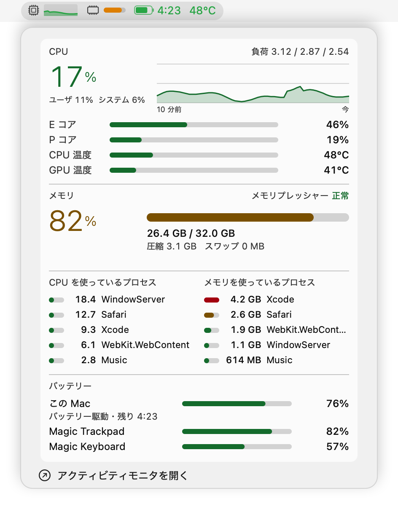
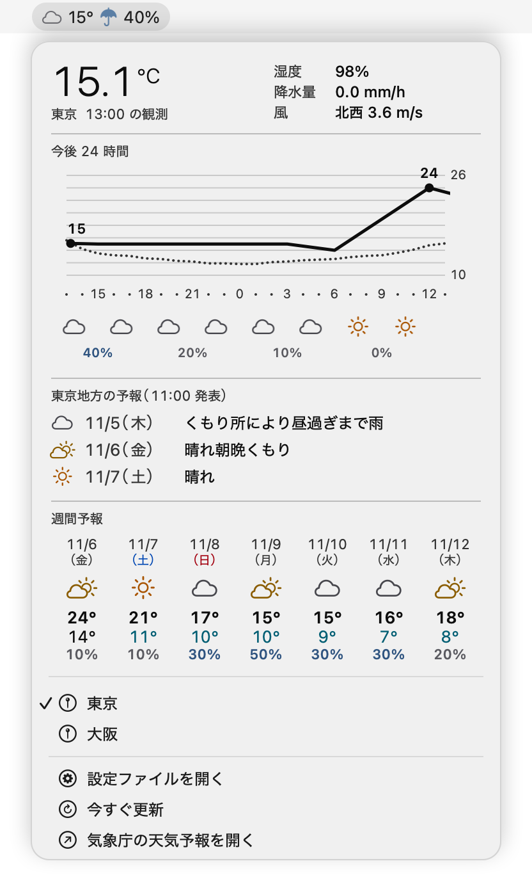
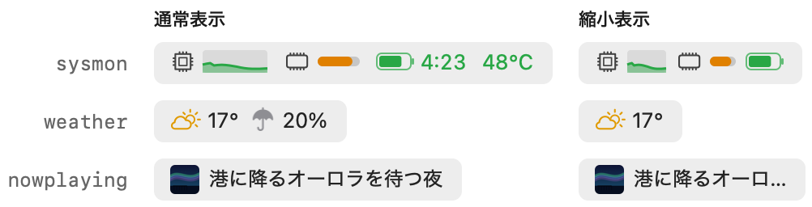
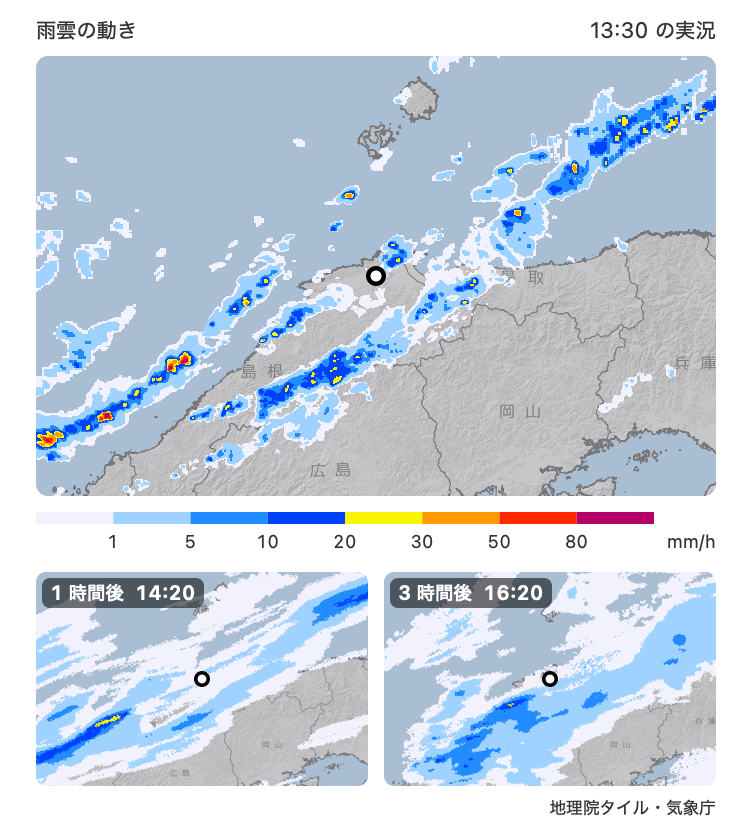

# swiftbar-cards

[English](README.md)

メニューの中身を、文字の行ではなく画像のカードで描く [SwiftBar](https://github.com/swiftbar/SwiftBar) のプラグインです。

| プラグイン | メニューバー | カード |
|---|---|---|
| `nowplaying` | Music.app で再生中の曲のアートワークと曲名 | アートワーク・曲名・アーティスト・アルバム・再生位置 (クリックで曲のページを開く) と、一時停止・次の曲・「アーティスト - タイトル」のコピーの項目 |
| `sysmon` | CPU の推移、メモリ、本体のバッテリーと電池で動いているときの残り時間 (MacBook)、温度 | CPU (使用率・過去 10 分の推移・E / P コア・温度)、メモリ、CPU とメモリを使っているプロセスの上位、バッテリー (MacBook では本体の残量と、充電中か・残り時間・満充電までの時間。Bluetooth 機器の残量も) |
| `weather` | 今日の天気のアイコン、現在の気温、降水確率、警報の印 | 気象庁のデータによる現在の観測値、今後 24 時間の気温のグラフと天気・降水確率・風、地方の予報、平年値を添えた週間予報 |

カードは小さな Swift のプログラムが描き、画像として SwiftBar に渡します。ライトモードとダークモードで別の色を使います。表示は macOS の言語の設定に合わせて、日本語か英語になります。

<p align="center">
  <picture>
    <source media="(prefers-color-scheme: dark)" srcset="docs/images/ja/nowplaying-dark.png">
    
  </picture>
  <picture>
    <source media="(prefers-color-scheme: dark)" srcset="docs/images/ja/sysmon-dark.png">
    
  </picture>
  <picture>
    <source media="(prefers-color-scheme: dark)" srcset="docs/images/ja/weather-dark.png">
    
  </picture>
</p>

`nowplaying` と `sysmon` の画像は `samples/` の架空の値で描いたもので、`weather` の画像は東京の実際の予報です (2 つめの地点に大阪を設定しています)。

## 必要なもの

- macOS 15 以降の Apple シリコンの Mac (M1 Max・macOS 26 で確かめています)
- 常駐型 (streamable) のプラグインに対応した SwiftBar
- `swiftc` を使うための Xcode Command Line Tools (`xcode-select --install`)
- `weather` で現在地を出すには、位置情報サービス (無くても東京を表示します)

## インストール

```sh
git clone https://github.com/delphinus/swiftbar-cards.git
```

SwiftBar の設定で、プラグインのフォルダをクローンした中の `plugins` ディレクトリにします。プラグインは隣の `Sources` と `scripts` ディレクトリから Swift のプログラムをビルドするので、プラグインのファイルを 1 つずつ別の場所へコピーしたりリンクしたりしないでください。

各プラグインは、初回とソースを変えたときに Swift のプログラムをコンパイルします。できたバイナリは `~/Library/Caches/` の下に置かれます。

`nowplaying` は再生中の曲を Apple Events (ScriptingBridge) で Music.app に問い合わせます。初回は、SwiftBar から Music を操作してよいかを macOS が尋ねます。ライブラリに入れずに Apple Music のカタログから直接再生している曲は、Music.app がアートワークを渡さないので、iTunes Search API で探します。このとき曲名・アーティスト・アルバム名を Apple に送ります。

メニューのカードをクリックすると、再生中の曲のページを開きます。Apple Music・Bandcamp・SoundCloud・Beatport・Discogs の順に曲名とアーティストで探し、最初に見つかったページを開きます (どこで開くかは、カードにマウスを載せると出ます)。曲が変わるたびに、曲名・アーティスト・アルバム名をこれらのサービスに送ります。どこにも見つからなければ、カードはクリックできません。

`weather` は現在地を調べるのに位置情報サービスを使います。初回は、`swiftbar-cards` というアプリに位置情報の利用を許可するかを macOS が尋ねます (詳しくは「[設定](#設定)」)。

## 言語

macOS の優先する言語の先頭が日本語なら日本語で、それ以外なら英語で表示します。設定によらず決めたいときは、SwiftBar に環境変数 `SWIFTBAR_CARDS_LANG` (`ja` か `en`) を渡します。

英語のとき、`weather` は観測点や区域の名前に気象庁の英語名を使います。予報の文は気象庁が日本語でしか出していないので、代わりに各日の天気コードの英語名 (「Partly cloudy」など) を出します。

## メニューバーが狭いとき

MacBook ではメニューバーのノッチの右側が狭く、収まらない項目は macOS が隠してしまいます。そのときはメニューバーの項目を縮めて描き (縮小表示)、できるだけ全部が出るようにします。通常表示との違いは次のとおりです。

<p align="center">
  <picture>
    <source media="(prefers-color-scheme: dark)" srcset="docs/images/ja/menubar-density-dark.png">
    
  </picture>
</p>

| プラグイン | 項目 | 通常表示 | 縮小表示 |
|---|---|---|---|
| `sysmon` | CPU のグラフ | 幅 40pt | 幅 24pt |
| | メモリの棒 | 幅 26pt | 幅 16pt |
| | 温度 | いつも出す | 70°C 以上のときだけ出す |
| | 電池の残り時間 | 電池で動いているときに出す | 電池で動いていて、残量が 20% 未満のときだけ出す |
| | 項目の間隔 | 10pt | 6pt |
| `weather` | 降水確率 | いつも出す | 30% 以上のときだけ出す |
| | 項目の間隔 | 7pt | 5pt |
| `nowplaying` | 曲名 | 220pt で切る | 100pt で切る |

どちらの表示でも、次のものは変わりません。

- `sysmon` の電池の形。残量は塗りの長さと色 (40% 以上は緑、20% 以上は橙、20% 未満は赤) で表し、電源につながっていれば稲妻 (充電中) かプラグ (充電していない) を重ねます。
- `sysmon` は電源につながっているとき、満充電までの時間をメニューバーに出しません (カードには出します)。macOS は満充電の手前から残量を 100% と見せ、そこから満充電までに 30 分ほどかかるので、メニューバーで見せても役に立たないためです。
- `weather` の天気のアイコン・気温・警報の印。

縮小表示の電池の残り時間は、幅を 30pt ほど取ります。縮めてもなお収まらなくなることがありますが、電池で動いていて残りが少ないときは、ほかの項目より大事なので出します。

項目が隠れているかを調べるため、プラグインは `~/Library/Caches/swiftbar-cards/` に小さなアプリ (`swiftbar-cards`。Dock にもメニューバーにも出ません) をビルドし、常駐させます。このアプリは 2 秒ごとに、macOS が隠れた項目のボタンを出しているかと、項目の並んでいる位置をアクセシビリティ API で読みます。縮めるか戻すかは、プラグインごとに決めます。項目が隠れていれば、縮めていないプラグインのうち優先順の低いものから縮めます。空いている幅に戻しても収まるプラグインがあれば、そのうち優先順の高いものを、空きが 6 秒続いたら (縮めてから 1 分以上たっていれば) 元に戻します。優先順は `sysmon`、`weather`、`nowplaying` の順です。上のプラグインが収まらなくても、下のプラグインが収まれば下だけを戻します。ただし、下のプラグインを縮めれば上が収まるときは、下を縮めて空きを上に回します。たとえば `weather` が戻っていて `sysmon` を戻す幅が足りないとき、`weather` を縮めれば足りるなら `weather` を縮めて `sysmon` を戻し、縮めても足りなければ `weather` を戻したままにします。読むのはメニューバーの項目の位置・大きさ・識別子だけで、クリックや入力などの操作は一切しません。

初回は、`swiftbar-cards` にアクセシビリティの使用を許可するかを macOS が尋ねます (「プライバシーとセキュリティ」の「アクセシビリティ」。新しい macOS では「デバイスの制御とデータへのアクセス」)。このアプリはアドホック署名なので、更新でアプリが変わると許可が通らなくなります。プラグインはアプリをビルドし直したときに一覧から古い項目を消し、アプリがもう一度尋ねるので、改めて ON にしてください。

許可が無いとき (と、隠れた項目のボタンが無い macOS) は、外部のディスプレイが繋がっていなければ縮めます。SwiftBar はどのディスプレイのメニューバーにも同じ画像を出すので、外部のディスプレイが 1 台でも繋がっていれば縮めません。

これらによらず決めたいときは、SwiftBar に環境変数 `SWIFTBAR_CARDS_COMPACT` (`on` か `off`) を渡します。

## 設定

`weather` は、現在地にいちばん近い (気温を観測している) アメダスの観測点の天気を表示します。現在地は macOS の位置情報サービスで調べます。SwiftBar 自身は位置情報を使えないので、位置情報を読むだけの小さなアプリ (`swiftbar-cards`。Dock にもメニューバーにも出ません) を `~/Library/Caches/swiftbar-weather/` に作って使います。初回は、このアプリに位置情報の利用を許可するかを macOS が尋ねます。現在地は 10 分ごとに調べ直します。許可されていないときや取得できないときは東京を表示し、メニューに理由を出します。

ほかの地点も見るには、アメダスの観測点の名前 ([気象庁のアメダスのページ](https://www.jma.go.jp/bosai/amedas/)に出ているもの) を `~/.config/swiftbar-cards/weather.conf` に書きます。

```ini
place=東京
place=大阪
```

メニューには、先頭の「現在地（府中）」(括弧の中は使っている観測点) に続いて、書いた地点が並び、選んで切り替えられます。各地点の項目には、その地点を最後に更新したときの天気のアイコン・気温・降水確率を、メニューバーと同じ形で添えます。表示している地点はアイコンが塗りつぶされ、選んだ地点は覚えておきます。ファイルを書き換えたあとは、メニューの「今すぐ更新」で、次の更新 (10 分ごと) を待たずに反映できます。メニューの「設定ファイルを開く」を選ぶと、ファイルが無ければ説明付きのひな形を作って開きます。

予報の区域は観測点から決まります。同じ地域の中で、予報の気温の代表の地点が観測点にいちばん近い区域を使います。

観測点のある市町村 (現在地では、いま実際にいる市町村) に警報・注意報が出ていれば、カードの上に「千代田区の警報・注意報」として並べます。項目を選ぶと、気象庁の警報・注意報のページがその市町村で開きます。警報・危険警報・特別警報のときは、メニューバーにも気象庁の段階の色 (警報は赤、危険警報は紫、特別警報は黒か白) の印を出します。注意報は雷や乾燥などでよく出ているので、メニューを開いたときだけ見せます。

カードのすぐ下の「雨雲の動き」には、表示している地点のまわりの雨の様子を添えます (「雨 1〜5 mm/h」「1 時間後に雨の予測」「周辺に雨雲（最大 30〜50 mm/h）」「雨雲なし」)。項目にマウスを載せると、気象庁の[雨雲の動き](https://www.jma.go.jp/bosai/nowc/)の地図を出します。地点を中心に約 300km の範囲の実況 (高解像度降水ナウキャスト) と、1 時間後・3 時間後の予測 (降水短時間予報。前 1 時間の降水量) です。地図は[国土地理院の地理院タイル](https://maps.gsi.go.jp/development/ichiran.html) (陰影起伏図と白地図) に雨域を重ねたもので、項目を選ぶと気象庁のページがその地点で開きます。

<p align="center">
  <picture>
    <source media="(prefers-color-scheme: dark)" srcset="docs/images/ja/weather-radar-dark.png">
    
  </picture>
</p>

この画像は、描いた時点で雨の降っていた地点のものです。

気象庁のデータを取り直せなかったときは、前に取れたものを表示し、メニューバーに灰色の雲の印を出します。メニューのカードの上にもその旨を出します。

週間予報の気温は、府県に 1 つの地点しか配られないことがあります (山口県なら下関だけ)。その地点が予報の気温の代表の地点と違うときは、見出しを「週間予報（下関）」のようにして地点を示し、短期予報がある日 (今日と明日) は代表の地点の短期予報の値を出します。

予報の日付の曜日は、土曜を青、日曜と祝日・休日を赤で出します。祝日・休日は、[内閣府の「国民の祝日」の一覧](https://www8.cao.go.jp/chosei/shukujitsu/gaiyou.html) の CSV を週に 1 回取って調べます (振替休日と国民の休日も含みます)。

現在地を先頭以外に置くには、置きたい位置に `place=現在地` (または `place=here`) と書きます。

```ini
place=東京
place=現在地
```

同じ名前の観測点が複数あるときは、メニューに候補が観測点の番号付きで出ます。名前の代わりに番号を書いてください。

```ini
place=44116
```

## 開発

- Swift のプログラムは Swift のパッケージの形 (`Package.swift`) にしてあるので、`swift build` やエディタの補完がそのまま使えます。プラグイン自身は SwiftPM を通さず、`swiftc` で直接コンパイルします。
- `tests/smoke.sh` は、Swift のプログラムをビルドし、各プラグインを動かして、メニューバーの行とカードの画像が出るかを確かめます。CI が push のたびに流します。
- `samples/render.sh` は `docs/images/en/` と `docs/images/ja/` の画像を描き直します。`nowplaying` と `sysmon` は `--render <JSON> <出力先>` で、与えた値から 1 回だけカードを描けます。値は `samples/` にあります。`weather` は `--once` で、メニューを 1 回だけ出して終わります。また `--render-menubar <天気のアイコン> <気温> <降水確率> <出力先>` で、与えた値からメニューバーの項目だけを描けます (通常表示と縮小表示を並べた画像に使います)。縮めて描くかは `SWIFTBAR_CARDS_COMPACT` で決め打ちします。
- リリースは [Semantic Versioning](https://semver.org/lang/ja/) に従い、`vX.Y.Z` のタグを打ちます。版はすべてのプラグインで共通で、ヘッダの `<xbar.version>` に書きます (SwiftBar のプラグインの設定画面に出ます)。そろっているかは `tests/smoke.sh` が確かめます。
- 取得や読み込みに失敗したときは、理由を macOS の統合ログに書きます (SwiftBar は常駐型のプラグインの標準エラーを見せないため)。subsystem は `dev.delphinus.swiftbar-cards`、category はプラグインの名前 (`weather`・`sysmon`・`nowplaying`・`locate`・`menubar`) です。`/usr/bin/log show --last 1h --predicate 'subsystem == "dev.delphinus.swiftbar-cards"'` で見られます (zsh では `log` が組み込みコマンドとぶつかるので、フルパスで書きます)。
- `scripts/update-telops.sh` は、天気コードの表 `data/jma-telops.json` (英語名・日本語名・代表の天気) を、気象庁の予報のページに埋め込まれた表から作り直します。天気のアイコンは、この表の代表の天気 (晴・曇・雨・雪) で決めます。

## 謝辞

`sysmon` は、[macmon](https://github.com/vladkens/macmon) (MIT License) と同じ方法で SMC から温度を読んでいます。

## ライセンス

[MIT](LICENSE)
