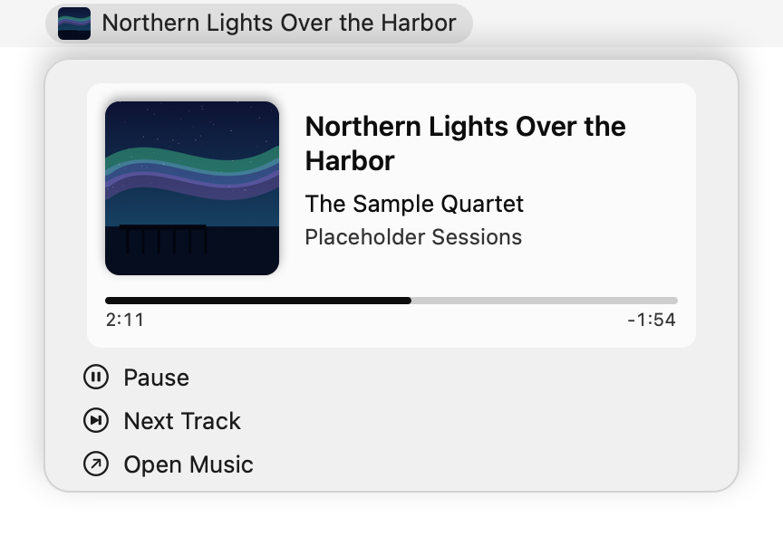
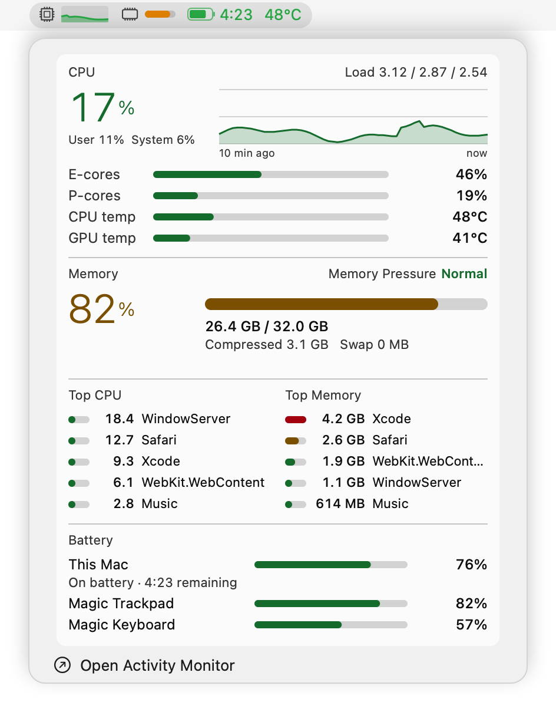
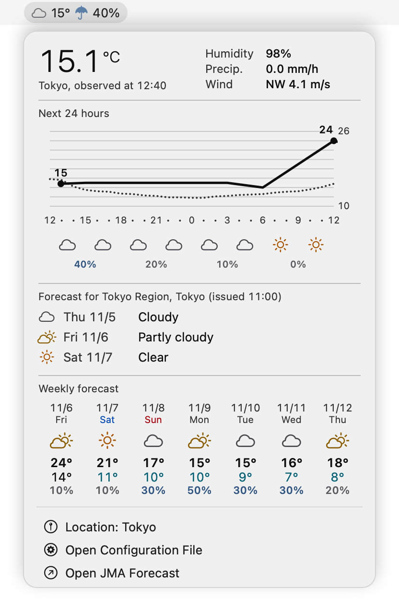
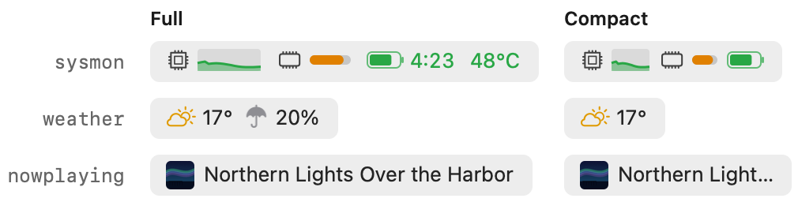
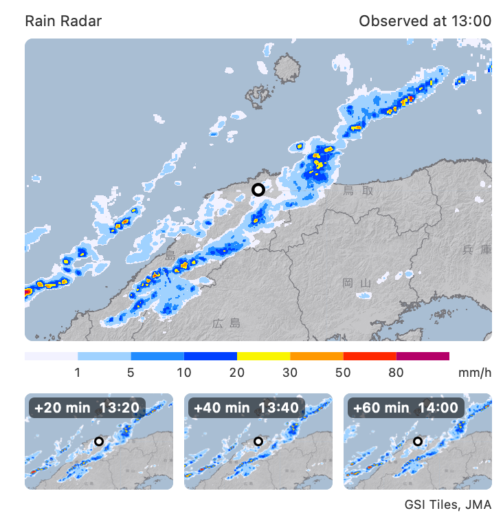

# swiftbar-cards

[日本語](README.ja.md)

[SwiftBar](https://github.com/swiftbar/SwiftBar) plugins that render their dropdowns as image cards instead of rows of text.

| Plugin | Menu bar | Card |
|---|---|---|
| `nowplaying` | Artwork and title of the track playing in Music.app | Artwork, title, artist, album, and playback position (click to open the track's page), with play/pause, next-track, and copy "Artist - Title" items |
| `sysmon` | CPU history, memory, the Mac's own battery with time remaining when on battery (on a MacBook), and temperature | CPU (usage, last 10 minutes, E/P cores, temperatures), memory, top processes by CPU and memory, and batteries: the Mac's own battery (on a MacBook, with charging status and time remaining or until full) and Bluetooth devices |
| `weather` | Today's weather icon, current temperature, chance of rain, and a warning mark | Current observations, a 24-hour temperature graph with weather, chance of rain, and wind, the regional forecast, and the weekly forecast with climate normals from the Japan Meteorological Agency (JMA) |

Each card is drawn by a small Swift program and passed to SwiftBar as an image, with separate colors for light and dark appearances. The plugins show English or Japanese text, following the language setting of macOS.

<p align="center">
  <picture>
    <source media="(prefers-color-scheme: dark)" srcset="docs/images/en/nowplaying-dark.png">
    
  </picture>
  <picture>
    <source media="(prefers-color-scheme: dark)" srcset="docs/images/en/sysmon-dark.png">
    
  </picture>
  <picture>
    <source media="(prefers-color-scheme: dark)" srcset="docs/images/en/weather-dark.png">
    
  </picture>
</p>

The `nowplaying` and `sysmon` images use made-up values from `samples/`; the `weather` image shows a real forecast for Tokyo, with Osaka as a second location.

## Requirements

- macOS 15 or later on Apple Silicon (tested on an M1 Max with macOS 26)
- SwiftBar with support for streamable plugins
- Xcode Command Line Tools (`xcode-select --install`), for `swiftc`
- Location Services, for showing your location in `weather` (without them, it shows Tokyo)

## Installation

```sh
git clone https://github.com/delphinus/swiftbar-cards.git
```

In SwiftBar's settings, set the plugin folder to the `plugins` directory of the clone. The plugins build their Swift programs from the sibling `Sources` and `scripts` directories, so do not copy or link individual plugin files elsewhere.

Each plugin compiles its Swift program on first run and again whenever the source changes. The binaries are kept under `~/Library/Caches/`.

`nowplaying` asks Music.app for the current track through Apple Events (ScriptingBridge). The first time it runs, macOS asks whether SwiftBar may control Music. Music.app does not hand over the artwork of tracks played straight from the Apple Music catalog (not added to your library), so for those `nowplaying` looks it up with the iTunes Search API, sending the track name, artist and album to Apple.

Clicking the card in the menu opens the page of the current track. `nowplaying` searches Apple Music, Bandcamp, SoundCloud, Beatport and Discogs in that order by title and artist, and opens the first match (hover over the card to see which one). Each time the track changes, it sends the track name, artist and album to these services. If nothing matches, the card is not clickable.

`weather` finds your location through Location Services. The first time, macOS asks whether an app named `swiftbar-cards` may use your location (see [Configuration](#configuration)).

## Language

The plugins use Japanese when the first preferred language in macOS is Japanese, and English otherwise. To choose one regardless of the setting, set `SWIFTBAR_CARDS_LANG` to `ja` or `en` for SwiftBar.

In English, `weather` uses JMA's English names for stations and areas. JMA publishes the forecast text only in Japanese, so the card shows the English name of each day's weather code (such as "Partly cloudy") instead.

## Narrow menu bars

On a MacBook, the menu bar has little room to the right of the notch, and macOS hides the items that do not fit. When that happens, the plugins draw shorter menu bar items (the compact layout) so that as many of them as possible stay visible. The compact layout differs from the full one as follows:

<p align="center">
  <picture>
    <source media="(prefers-color-scheme: dark)" srcset="docs/images/en/menubar-density-dark.png">
    
  </picture>
</p>

| Plugin | Part | Full | Compact |
|---|---|---|---|
| `sysmon` | CPU graph | 40pt wide | 24pt wide |
| | Memory bar | 26pt wide | 16pt wide |
| | Temperature | Always shown | Shown only at 70°C or higher |
| | Battery time | Shown when on battery | Shown only when on battery and below 20% |
| | Gaps between parts | 10pt | 6pt |
| `weather` | Chance of rain | Always shown | Shown only at 30% or higher |
| | Gaps between parts | 7pt | 5pt |
| `nowplaying` | Title | Cut at 220pt | Cut at 100pt |

These stay the same in both layouts:

- The battery shape in `sysmon`. Its fill and color show the charge (green at 40% or more, orange at 20% or more, red below 20%), with a bolt (charging) or a plug (not charging) on top when the Mac is on power.
- On power, `sysmon` does not show the time until full in the menu bar (the card still shows it). macOS shows 100% before the battery is actually full and then takes about 30 minutes to finish charging, so the time is of little use in the menu bar.
- The weather icon, temperature, and warning mark in `weather`.

In the compact layout, the battery time takes about 30pt, and may make the items overflow even after they are shortened. It is shown anyway, because when the Mac is on battery and running low, it matters more than the other items.

To find out whether items are hidden, the plugins build a small app (`swiftbar-cards`, which appears neither in the Dock nor in the menu bar) under `~/Library/Caches/swiftbar-cards/` and keep it running. Every 2 seconds it checks, through the Accessibility API, whether macOS shows the button for hidden menu bar items, and where the items are. Each plugin is shortened or restored on its own. When items are hidden, the lowest-priority plugin still in the full layout is shortened first. When the room left is enough to restore a shortened plugin, the highest-priority one that fits goes back to the full layout after the room has been there for 6 seconds (and at least a minute after it was shortened). The order is `sysmon`, `weather`, then `nowplaying`. A lower-priority plugin is restored when it fits even if a higher-priority one does not. But when shortening a lower-priority plugin would make room for a higher-priority one, the lower one is shortened to hand its room over. For example, if `weather` is restored and there is not enough room for `sysmon`, `weather` is shortened so that `sysmon` can come back, but only when that frees enough room; otherwise `weather` stays as it is. The app only reads the position, size and identifier of menu bar items; it never clicks, types, or changes anything.

The first time, macOS asks whether `swiftbar-cards` may use Accessibility (listed under **Accessibility** in **Privacy & Security**; the name of the list differs on newer versions of macOS). The app is signed ad hoc, so macOS stops honoring the permission whenever an update changes the app. When the plugins rebuild the app, they remove its old entry from the list, and the app asks again; turn it on again.

Without the permission (or on a version of macOS without the button for hidden items), the plugins draw the shorter items when no external display is connected. SwiftBar shows the same image on the menu bar of every display, so they draw the full items whenever any external display is connected.

To choose one regardless of all this, set `SWIFTBAR_CARDS_COMPACT` to `on` or `off` for SwiftBar.

## Configuration

`weather` shows the weather at the AMeDAS station (one that observes temperature) nearest to your current location, found through macOS Location Services. SwiftBar itself cannot use Location Services, so the plugin builds a small app that only reads the location (`swiftbar-cards`, which appears neither in the Dock nor in the menu bar) under `~/Library/Caches/swiftbar-weather/`. The first time, macOS asks whether this app may use your location. The location is checked again every 10 minutes. When access is not allowed or the location is unavailable, the plugin shows Tokyo and says why in the menu.

To add other locations, write names of AMeDAS stations (in Japanese, as listed on the [JMA AMeDAS page](https://www.jma.go.jp/bosai/amedas/)) to `~/.config/swiftbar-cards/weather.conf`:

```ini
place=東京
place=大阪
```

The menu lists **My Location (Fuchu)** first (with the station in use in parentheses), followed by the stations you wrote, and you can switch between them. Each item shows the weather icon, temperature, and chance of rain from the last time that location was updated, the same as in the menu bar. The icon of the one shown is filled, and the plugin remembers the one you chose. After editing the file, choose **Refresh Now** to apply it without waiting for the next update (every 10 minutes). The **Open Configuration File** item in the menu creates this file with comments if it does not exist.

The plugin finds the forecast area from the station: it uses the forecast area whose representative temperature point is nearest to the station, within the same region.

When weather warnings or advisories are in effect for the municipality of the station (for My Location, the municipality you are actually in), the menu lists them above the card, under a heading like **Warnings and Advisories for Chiyoda City**. Choosing one opens the JMA warnings page for that municipality. For warnings and higher (warning, urgent warning, and emergency warning), the menu bar also shows a mark in the JMA color for the level: red, purple, and black or white. Advisories, such as for thunderstorms or dry air, are common, so they appear only in the menu.

Right below the card, **Rain Radar** sums up the rain around the location shown ("Raining, 1–5 mm/h", "Rain expected in 1 hour", "Rain nearby (up to 30–50 mm/h)", or "No rain nearby"). Hover over it to see the map of the JMA [rain radar](https://www.jma.go.jp/bosai/nowc/): the current rain in about 300 km around the location (high-resolution precipitation nowcasts), and the forecasts for 1 and 3 hours ahead (very-short-range precipitation forecasts, showing the amount over the previous hour). The rain is drawn over [GSI Tiles](https://maps.gsi.go.jp/development/ichiran.html) (the hillshade and blank maps) from the Geospatial Information Authority of Japan. Choose the item to open the JMA page at that location.

<p align="center">
  <picture>
    <source media="(prefers-color-scheme: dark)" srcset="docs/images/en/weather-radar-dark.png">
    
  </picture>
</p>

The image shows a place where it was raining when it was drawn.

When the plugin cannot update the data from JMA, it shows the data from before with a gray cloud mark in the menu bar, and says so above the card in the menu.

The weekly forecast may give temperatures for only one point in the prefecture (only Shimonoseki in Yamaguchi). When that point is not the representative temperature point, the heading names it, as in "Weekly forecast (Shimonoseki)", and the days covered by the short-range forecast (today and tomorrow) show the short-range values for the representative point instead.

The weekdays of the forecast dates are blue for Saturdays and red for Sundays and national holidays. Holidays come from the CSV of the [Cabinet Office list of national holidays](https://www8.cao.go.jp/chosei/shukujitsu/gaiyou.html), fetched once a week (substitute holidays and citizens' holidays included).

To put your location somewhere other than first, write `place=here` (or `place=現在地`) in that position:

```ini
place=東京
place=here
```

When more than one station has the same name, the menu lists them with their station numbers. Write the number instead of the name:

```ini
place=44116
```

## Development

- The Swift programs are laid out as a Swift package (`Package.swift`), so `swift build` and editors work as usual. The plugins themselves compile them with `swiftc` directly, without SwiftPM.
- `tests/smoke.sh` builds the Swift programs, runs each plugin, and checks that the menu bar line and the card image come out. CI runs it on every push.
- `samples/render.sh` redraws the images in `docs/images/en/` and `docs/images/ja/`. `nowplaying` and `sysmon` can draw a card once from given values with `--render <JSON> <output directory>`; the values are in `samples/`. `weather` prints its menu once and exits with `--once`, and draws only the menu bar item from given values with `--render-menubar <weather icon> <temperature> <chance of rain> <output directory>` (used for the image comparing the full and compact layouts). `SWIFTBAR_CARDS_COMPACT` chooses which layout to draw.
- Releases follow [Semantic Versioning](https://semver.org/) and are tagged `vX.Y.Z`. All plugins share the version in their `<xbar.version>` header (shown in SwiftBar's plugin settings); `tests/smoke.sh` checks that they match.
- When fetching or reading something fails, the reason goes to the macOS unified log (SwiftBar does not show the standard error of streamable plugins). The subsystem is `dev.delphinus.swiftbar-cards` and the category is the plugin name (`weather`, `sysmon`, `nowplaying`, `locate`, `menubar`). View it with `/usr/bin/log show --last 1h --predicate 'subsystem == "dev.delphinus.swiftbar-cards"'` (use the full path in zsh, where `log` is a builtin).
- `scripts/update-telops.sh` regenerates `data/jma-telops.json`, the table of weather codes (English name, Japanese name, and representative weather), from the table embedded in the JMA forecast page. The weather icons follow the representative weather in this table (clear, cloudy, rain, or snow).

## Acknowledgements

`sysmon` reads temperatures from the SMC in the same way as [macmon](https://github.com/vladkens/macmon) (MIT License).

## License

[MIT](LICENSE)
