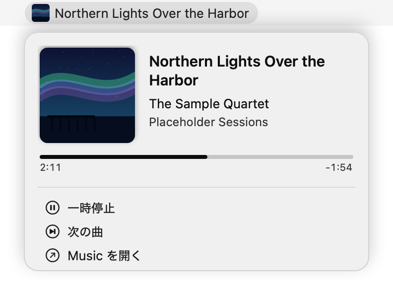
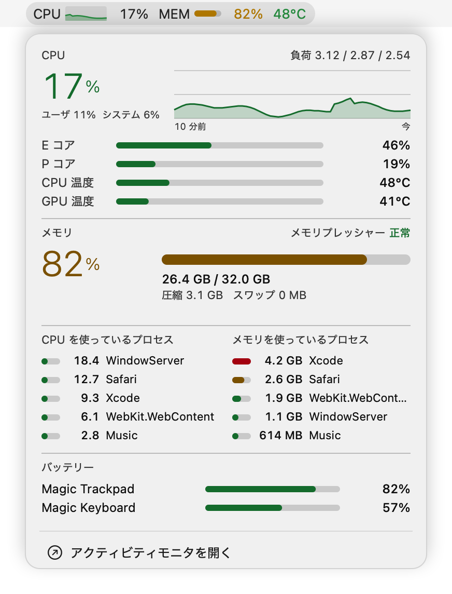
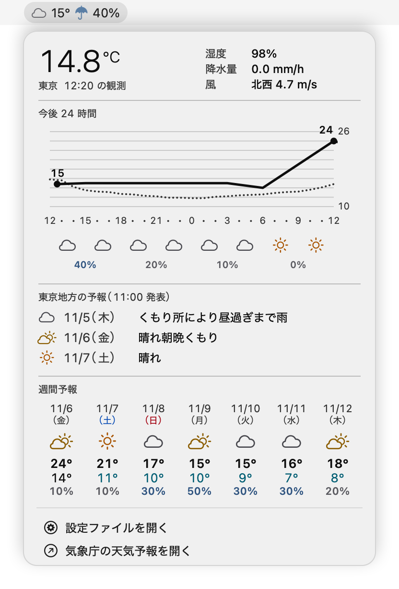

# swiftbar-cards

[日本語](README.ja.md)

[SwiftBar](https://github.com/swiftbar/SwiftBar) plugins that render their dropdowns as image cards instead of rows of text.

| Plugin | Menu bar | Card |
|---|---|---|
| `nowplaying` | Artwork and title of the track playing in Music.app | Artwork, title, artist, album, and playback position, with play/pause and next-track items |
| `sysmon` | CPU history and usage, memory, and temperature | CPU (usage, last 10 minutes, E/P cores, temperatures), memory, top processes by CPU and memory, and Bluetooth device batteries |
| `weather` | Today's weather icon, current temperature, and chance of rain | Current observations, a 24-hour temperature graph, the regional forecast, and the weekly forecast from the Japan Meteorological Agency (JMA) |

Each card is drawn by a small Swift program and passed to SwiftBar as an image, with separate colors for light and dark appearances.

<p align="center">
  <picture>
    <source media="(prefers-color-scheme: dark)" srcset="docs/images/nowplaying-dark.png">
    
  </picture>
  <picture>
    <source media="(prefers-color-scheme: dark)" srcset="docs/images/sysmon-dark.png">
    
  </picture>
  <picture>
    <source media="(prefers-color-scheme: dark)" srcset="docs/images/weather-dark.png">
    
  </picture>
</p>

The `nowplaying` and `sysmon` images use made-up values from `samples/`; the `weather` image shows a real forecast for Tokyo.

## Requirements

- macOS on Apple Silicon (tested on an M1 Max with macOS 26)
- SwiftBar with support for streamable plugins
- Xcode Command Line Tools (`xcode-select --install`), for `swiftc`
- `jq`, for `weather`

## Installation

```sh
git clone https://github.com/delphinus/swiftbar-cards.git
```

In SwiftBar's settings, set the plugin folder to the `plugins` directory of the clone. The plugins build their Swift programs from the sibling `Sources` and `scripts` directories, so do not copy or link individual plugin files elsewhere.

Each plugin compiles its Swift program on first run and again whenever the source changes. The binaries are kept under `~/Library/Caches/`.

`nowplaying` asks Music.app for the current track through AppleScript. The first time it runs, macOS asks whether SwiftBar may control Music.

## Configuration

`weather` shows Tokyo unless configured. To change the location, write the name of an AMeDAS station (in Japanese, as listed on the [JMA AMeDAS page](https://www.jma.go.jp/bosai/amedas/)) to `~/.config/swiftbar-cards/weather.conf`:

```ini
place=横浜
```

The plugin finds the forecast area from the station: it uses the forecast area whose representative temperature point is nearest to the station, within the same region. The **設定ファイルを開く** (Open configuration file) item in the menu creates this file with comments if it does not exist.

When more than one station has the same name, the menu lists them with their station numbers. Pick one by number, which takes precedence over `place`:

```ini
amedas=44116
```

## Development

- The Swift programs are laid out as a Swift package (`Package.swift`), so `swift build` and editors work as usual. The plugins themselves compile them with `swiftc` directly, without SwiftPM.
- `tests/smoke.sh` builds the Swift programs, runs each plugin, and checks that the menu bar line and the card image come out. CI runs it on every push.
- `samples/render.sh` redraws the images in `docs/images/`. `nowplaying` and `sysmon` can draw a card once from given values with `--render <JSON> <output directory>`; the values are in `samples/`.

## Acknowledgements

`sysmon` reads temperatures from the SMC in the same way as [macmon](https://github.com/vladkens/macmon) (MIT License).

## License

[MIT](LICENSE)
