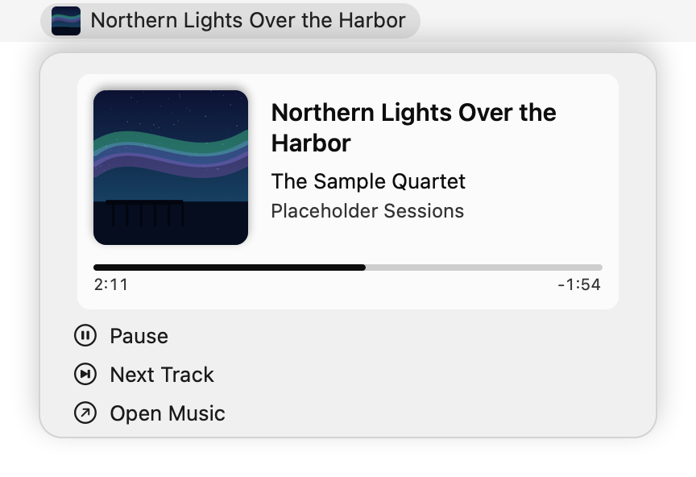
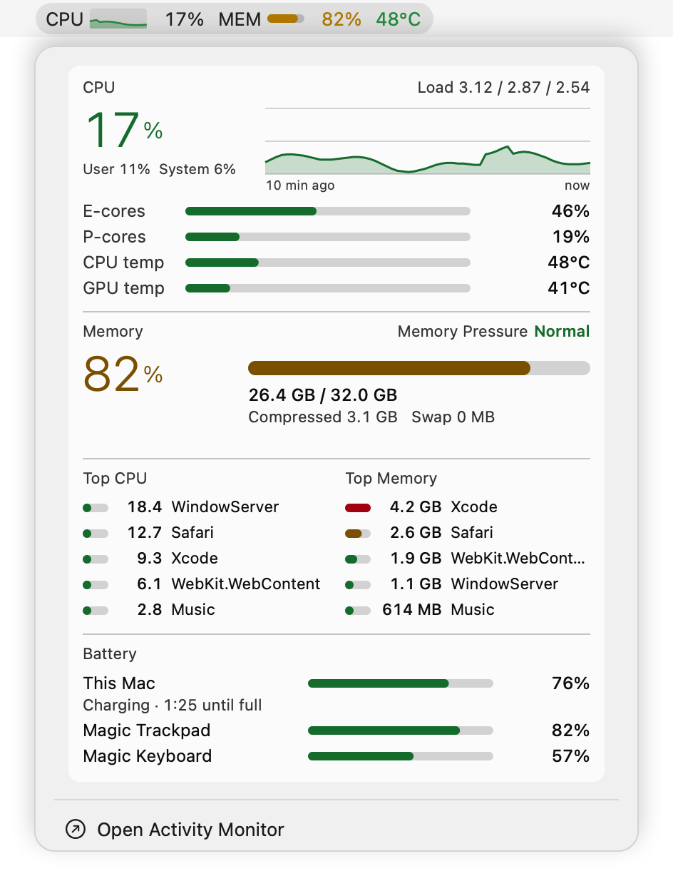
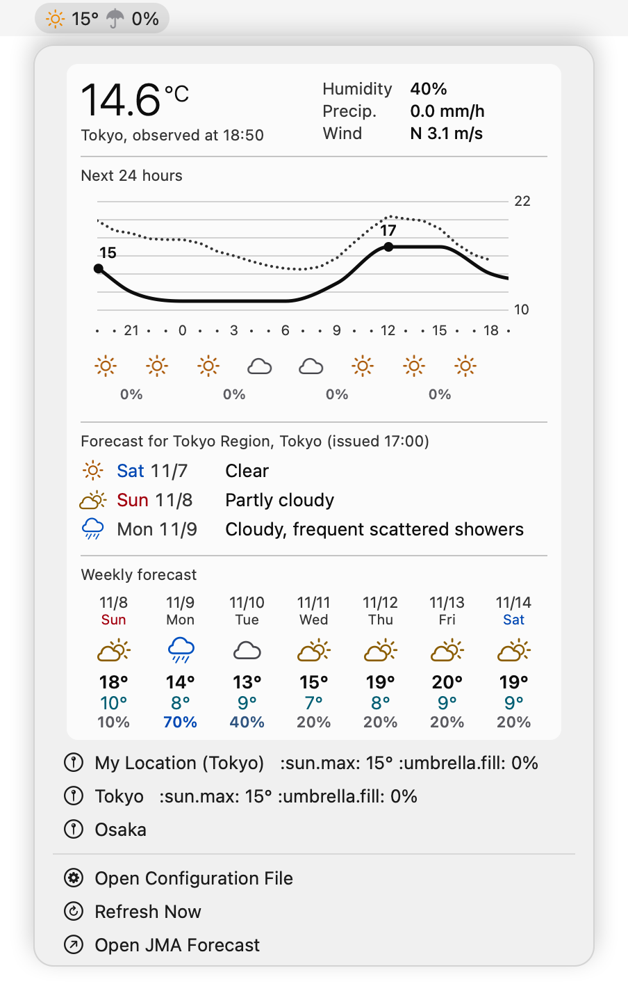

# swiftbar-cards

[日本語](README.ja.md)

[SwiftBar](https://github.com/swiftbar/SwiftBar) plugins that render their dropdowns as image cards instead of rows of text.

| Plugin | Menu bar | Card |
|---|---|---|
| `nowplaying` | Artwork and title of the track playing in Music.app | Artwork, title, artist, album, and playback position, with play/pause and next-track items |
| `sysmon` | CPU history, memory, the Mac's own battery with time remaining or until full (on a MacBook), and temperature | CPU (usage, last 10 minutes, E/P cores, temperatures), memory, top processes by CPU and memory, and batteries: the Mac's own battery (on a MacBook, with charging status and time remaining or until full) and Bluetooth devices |
| `weather` | Today's weather icon, current temperature, and chance of rain | Current observations, a 24-hour temperature graph, the regional forecast, and the weekly forecast from the Japan Meteorological Agency (JMA) |

Each card is drawn by a small Swift program and passed to SwiftBar as an image, with separate colors for light and dark appearances. The plugins show English or Japanese text, following the language setting of macOS.

<p align="center">
  <picture>
    <source media="(prefers-color-scheme: dark)" srcset="docs/images/en/nowplaying-dark.png">
    
  </picture>
  <picture>
    <source media="(prefers-color-scheme: dark)" srcset="docs/images/en/sysmon-dark.png">
    
  </picture>
  <picture>
    <source media="(prefers-color-scheme: dark)" srcset="docs/images/en/weather-dark.png">
    
  </picture>
</p>

The `nowplaying` and `sysmon` images use made-up values from `samples/`; the `weather` image shows a real forecast for Tokyo, with Osaka as a second location.

## Requirements

- macOS 15 or later on Apple Silicon (tested on an M1 Max with macOS 26)
- SwiftBar with support for streamable plugins
- Xcode Command Line Tools (`xcode-select --install`), for `swiftc`
- Location Services, for showing your location in `weather` (without them, it shows Tokyo)

## Installation

```sh
git clone https://github.com/delphinus/swiftbar-cards.git
```

In SwiftBar's settings, set the plugin folder to the `plugins` directory of the clone. The plugins build their Swift programs from the sibling `Sources` and `scripts` directories, so do not copy or link individual plugin files elsewhere.

Each plugin compiles its Swift program on first run and again whenever the source changes. The binaries are kept under `~/Library/Caches/`.

`nowplaying` asks Music.app for the current track through Apple Events (ScriptingBridge). The first time it runs, macOS asks whether SwiftBar may control Music. Music.app does not hand over the artwork of tracks played straight from the Apple Music catalog (not added to your library), so for those `nowplaying` looks it up with the iTunes Search API, sending the track name, artist and album to Apple.

`weather` finds your location through Location Services. The first time, macOS asks whether an app named `swiftbar-cards` may use your location (see [Configuration](#configuration)).

## Language

The plugins use Japanese when the first preferred language in macOS is Japanese, and English otherwise. To choose one regardless of the setting, set `SWIFTBAR_CARDS_LANG` to `ja` or `en` for SwiftBar.

In English, `weather` uses JMA's English names for stations and areas. JMA publishes the forecast text only in Japanese, so the card shows the English name of each day's weather code (such as "Partly cloudy") instead.

## Configuration

`weather` shows the weather at the AMeDAS station (one that observes temperature) nearest to your current location, found through macOS Location Services. SwiftBar itself cannot use Location Services, so the plugin builds a small app that only reads the location (`swiftbar-cards`, which appears neither in the Dock nor in the menu bar) under `~/Library/Caches/swiftbar-weather/`. The first time, macOS asks whether this app may use your location. The location is checked again every 10 minutes. When access is not allowed or the location is unavailable, the plugin shows Tokyo and says why in the menu.

To add other locations, write names of AMeDAS stations (in Japanese, as listed on the [JMA AMeDAS page](https://www.jma.go.jp/bosai/amedas/)) to `~/.config/swiftbar-cards/weather.conf`:

```ini
place=東京
place=大阪
```

The menu lists **My Location (Fuchu)** first (with the station in use in parentheses), followed by the stations you wrote, and you can switch between them. Each item shows the weather icon, temperature, and chance of rain from the last time that location was updated, the same as in the menu bar. The icon of the one shown is filled, and the plugin remembers the one you chose. After editing the file, choose **Refresh Now** to apply it without waiting for the next update (every 10 minutes). The **Open Configuration File** item in the menu creates this file with comments if it does not exist.

The plugin finds the forecast area from the station: it uses the forecast area whose representative temperature point is nearest to the station, within the same region.

The weekly forecast may give temperatures for only one point in the prefecture (only Shimonoseki in Yamaguchi). When that point is not the representative temperature point, the heading names it, as in "Weekly forecast (Shimonoseki)", and the days covered by the short-range forecast (today and tomorrow) show the short-range values for the representative point instead.

To put your location somewhere other than first, write `place=here` (or `place=現在地`) in that position:

```ini
place=東京
place=here
```

When more than one station has the same name, the menu lists them with their station numbers. Write the number instead of the name:

```ini
place=44116
```

## Development

- The Swift programs are laid out as a Swift package (`Package.swift`), so `swift build` and editors work as usual. The plugins themselves compile them with `swiftc` directly, without SwiftPM.
- `tests/smoke.sh` builds the Swift programs, runs each plugin, and checks that the menu bar line and the card image come out. CI runs it on every push.
- `samples/render.sh` redraws the images in `docs/images/en/` and `docs/images/ja/`. `nowplaying` and `sysmon` can draw a card once from given values with `--render <JSON> <output directory>`; the values are in `samples/`. `weather` prints its menu once and exits with `--once`.
- Releases follow [Semantic Versioning](https://semver.org/) and are tagged `vX.Y.Z`. All plugins share the version in their `<xbar.version>` header (shown in SwiftBar's plugin settings); `tests/smoke.sh` checks that they match.
- When fetching or reading something fails, the reason goes to the macOS unified log (SwiftBar does not show the standard error of streamable plugins). The subsystem is `dev.delphinus.swiftbar-cards` and the category is the plugin name (`weather`, `sysmon`, `nowplaying`, `locate`). View it with `/usr/bin/log show --last 1h --predicate 'subsystem == "dev.delphinus.swiftbar-cards"'` (use the full path in zsh, where `log` is a builtin).
- `scripts/update-telops.sh` regenerates `data/jma-telops.json`, the table of weather codes (English name, Japanese name, and representative weather), from the table embedded in the JMA forecast page. The weather icons follow the representative weather in this table (clear, cloudy, rain, or snow).

## Acknowledgements

`sysmon` reads temperatures from the SMC in the same way as [macmon](https://github.com/vladkens/macmon) (MIT License).

## License

[MIT](LICENSE)
